<!--
  ┌──────────────────────────────────────────────────────────────────┐
  │  Profile fully configured for Nanymous:                            │
  │  GitHub github.com/Nanymous · Telegram t.me/Nanymous               │
  │  Projects: veldo-docs & hodhod-docs                                │
  │  Setup guide: SETUP.md · Customization guide: CUSTOMIZATION.md     │
  └──────────────────────────────────────────────────────────────────┘
-->

<p align="center">
  <a href="https://github.com/Nanymous">
    
  </a>
</p>

<p align="center">
  <a href="https://github.com/Nanymous">
    
  </a>
</p>

<p align="center">
  <a href="https://github.com/Nanymous?tab=followers">
    
  </a>
  <a href="https://github.com/Nanymous?tab=repositories">
    
  </a>
  
</p>

<p align="center">
  I'm a developer who loves building across the stack — cross-platform apps with <b>Flutter</b>,
  robust backends with <b>Laravel</b> and <b>Flask</b>, and interactive 3D experiences on the web with <b>Three.js</b>.
  I care about clean code, thoughtful design, and learning something new every day.
</p>


## // About Me

```yaml
# identity.yml
name: Nanymous
location: [IRAN, Shiraz]
focus:
  mobile:  [Flutter, Dart]
  backend: [Laravel, Flask, PHP, Python]
  web:     [HTML, CSS, Three.js]
  data:    [MySQL, SQL Server, Redis]
currently_learning: JavaScript
familiar_with: C#
ask_me_about: [Dart, Flutter, Python, PHP, Laravel, Flask, Lua]
```


## // Technology Stack

### Programming Languages

<p align="center">
  
</p>

<p align="center"><sub><b>JavaScript</b> — currently learning&nbsp;&nbsp;·&nbsp;&nbsp;<b>C#</b> — familiarity</sub></p>

### Frontend & Backend

<p align="center">
  
</p>

### Databases

<p align="center">
  
  
  
</p>

### Tools & Environment

<p align="center">
  
</p>


## // GitHub Statistics

<p align="center">
  
  
</p>

<p align="center">
  
  
</p>

## // Streak Statistics

<p align="center">
  
</p>

## // Contribution Graph

<p align="center">
  <picture>
    <source media="(prefers-color-scheme: dark)" srcset="https://ssr-contributions-svg.vercel.app/_/Nanymous?chart=3dbar&format=svg&weeks=52&gap=0.6&scale=2&flatten=1&gradient=true&colors=00E5FF,38BDF8,818CF8,A855F7&strokeWidth=0.5&strokeColor=0B1226&animation=wave&dark=true&legend=true&legendPosition=bottomLeft"/>
    <source media="(prefers-color-scheme: light)" srcset="https://ssr-contributions-svg.vercel.app/_/Nanymous?chart=3dbar&format=svg&weeks=52&gap=0.6&scale=2&flatten=1&gradient=true&colors=00E5FF,38BDF8,818CF8,A855F7&strokeWidth=0.5&strokeColor=0B1226&animation=wave&dark=false&legend=true&legendPosition=bottomLeft"/>
    
  </picture>
</p>

<p align="center"><sub>An isometric view of my last 52 weeks of contributions — every cube is a day of building.</sub></p>

## // Contribution Snake

<p align="center">
  <picture>
    <source media="(prefers-color-scheme: dark)" srcset="https://raw.githubusercontent.com/Nanymous/Nanymous/output/github-snake-dark.svg"/>
    <source media="(prefers-color-scheme: light)" srcset="https://raw.githubusercontent.com/Nanymous/Nanymous/output/github-snake.svg"/>
    
  </picture>
</p>

<p align="center"><sub>The snake devours my contribution graph — regenerated daily by GitHub Actions.</sub></p>

## // GitHub Trophies

<p align="center">
  <picture>
    <source media="(prefers-color-scheme: dark)" srcset="https://trophy.ryglcloud.net/?username=Nanymous&theme=discord&no-bg=true&no-frame=true&margin-w=8&margin-h=8&column=-1"/>
    <source media="(prefers-color-scheme: light)" srcset="https://trophy.ryglcloud.net/?username=Nanymous&theme=flat&no-bg=true&no-frame=true&margin-w=8&margin-h=8&column=-1"/>
    
  </picture>
</p>


## // Currently Learning

<p align="center">
  
  
</p>

<p align="center">
  <b>JavaScript</b> is my current focus — I'm deepening my knowledge of the language and its ecosystem.
  Alongside it, I'm building familiarity with <b>C#</b>.
</p>

## // Featured Projects

<!-- Optional upgrade: swap the table for live repo pin cards (see CUSTOMIZATION.md §10). -->

| Project | Description | Tech Stack |
| :--- | :--- | :--- |
| [**veldo-docs**](https://github.com/Nanymous/veldo-docs) | Documentation site for **veldo** — a clean local REST API over Dasht accounting data. No SQL in clients, no build step. | JavaScript · OpenAPI |
| [**hodhod-docs**](https://github.com/Nanymous/hodhod-docs) | Operator documentation for **Hodhod** — a Persian-first, self-hosted messenger with browser-side end-to-end encryption. [Live docs ↗](https://nanymous.github.io/hodhod-docs/) | PHP · React 19 |

## // Contact & Social

<p align="center">
  <a href="https://github.com/Nanymous">
    
  </a>
  <a href="https://t.me/Nanymous">
    
  </a>
  <a href="mailto:manymuos@gmail.com">
    
  </a>
</p>

<p align="center">
  I'm always open to interesting conversations, ideas and collaboration — feel free to reach out.
</p>

<p align="center">
  
</p>

<p align="center"><sub>Designed &amp; built by <a href="https://github.com/Nanymous">Nanymous</a> · Profile README</sub></p>